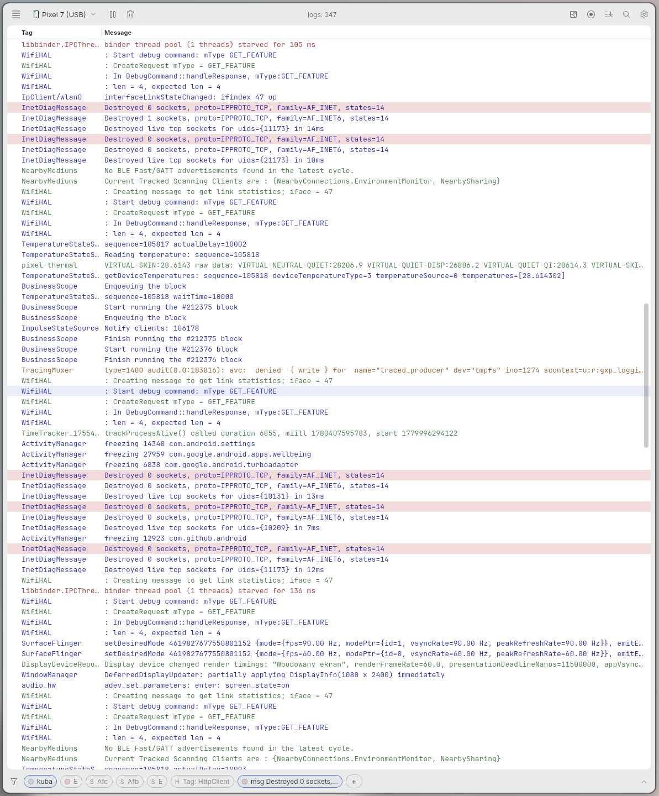
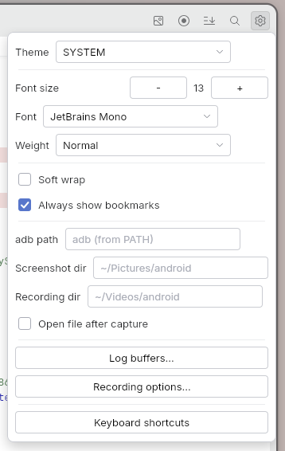
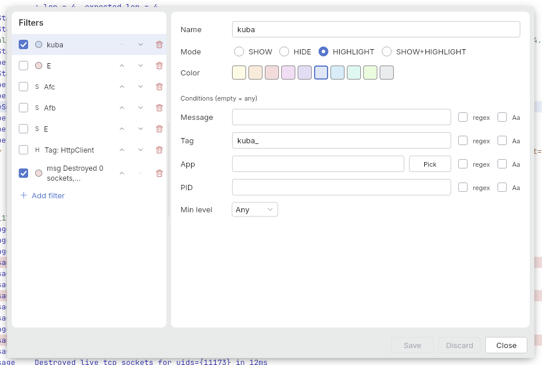

# LogLens

[](https://github.com/divinae/loglens/actions/workflows/ci.yml)
[](https://github.com/divinae/loglens/releases/latest)
[](#license)
[](https://ko-fi.com/divinae4535)

**Android Studio's Logcat, without Android Studio.** A desktop viewer for Android logs
(`adb logcat`): stream live logcat from a connected device, filter, highlight and search it,
open saved logs and bugreports, and capture screenshots and screen recordings. Built with
Kotlin Multiplatform, Compose for Desktop and the JetBrains Jewel (IntelliJ) look.

Inspired by [Android Studio's Logcat](https://developer.android.com/studio/debug/logcat) and [AndLogView](https://github.com/mlopatkin/andlogview).

Written with substantial AI assistance ([Claude Code](https://claude.com/claude-code)).



### Why you'll like it

- ⚡ **Live and resilient.** Streams from the device you pick, finds devices as they come, and a
  device that drops and returns reconnects without clearing or duplicating anything; pause holds
  the view while capture keeps going.
- 🔎 **Find it in seconds.** A small query language in the quick filter (`tag:Foo level>=W
  -tag:Spam age:5m`), saved filter rules that show, hide or highlight, and an in-view find bar.
- 💥 **Crashes stand out.** Crash, ANR and native crash records are marked, with a navigator to
  step between them; stack traces fold into one record, as in Android Studio.
- 🗂️ **Any log you have.** Saved `threadtime` logs, Android Studio `.logcat` exports, and full
  bugreports (`.txt` or `adb bugreport` `.zip`), with process names mined from them.
- 📸 **The device, a click away.** Screenshots to a file and the clipboard, screen recordings with
  Android Studio's options, and scrcpy for a live mirror.
- 🧩 **No Android Studio needed.** A native package with its own runtime: no JDK on the machine,
  only `adb`.

| Settings | Filter rules |
|---|---|
|  |  |

## Install

From the [latest release](https://github.com/divinae/loglens/releases/latest), with its own
runtime (no JDK needed), and `adb` on `PATH` (Android platform-tools) or set in its settings:

- **Debian / Ubuntu:** the `.deb`
  ```shell
  sudo apt install ./loglens_<version>_amd64.deb   # installs to /opt/loglens, with a menu entry
  ```
- **Any Linux:** the portable `.tar.gz`
  ```shell
  tar xzf loglens-v<version>-linux-x64.tar.gz
  ./loglens/bin/loglens
  ```
- **macOS and Windows:** build the `.dmg` or `.msi` on that system (see
  [Build and run](#build-and-run)); jpackage only packages for the system it runs on. On macOS,
  see [below](#macos-loglens-not-opened--cannot-be-opened) for the first launch.

## Features

<details>
<summary><b>Everything it does</b></summary>


- **Live logcat** — stream from the selected device, with automatic device detection and switching.
  Pause holds the display while capture keeps buffering (resume flushes the backlog); a device that
  drops and returns reconnects automatically without clearing or duplicating logs.
- **Process & device lifecycle banners** — Android-Studio-style `PROCESS STARTED/ENDED` lines for
  processes that logged in the session, plus `DEVICE DISCONNECTED/RECONNECTED` markers.
- **Logcat buffers** — pick `adb logcat -b` buffers (main, system, crash, radio, events, kernel).
- **Columns** — Index, Date, Time, Δt, PID, TID, App, Level, Tag, Message; toggleable and resizable (drag).
  The optional **Δt** column shows the elapsed time since the previous visible row (e.g. `+123ms`,
  `+1.45s`) — handy for spotting stalls between consecutive logs.
- **Filters** — SHOW / HIDE / HIGHLIGHT / SHOW_AND_HIGHLIGHT rules per field (message, tag, app, pid, level) with regex and case-sensitive options; colored highlighting; reordering; persisted to disk.
- **Quick filter** — a small query language in the quick-filter bar:
  - `foobar` — substring over the whole line (case-insensitive)
  - `"two words"` — quoted phrase
  - `tag:Foo`, `package:com.foo` (alias `app`/`pkg`), `msg:timeout` (alias `message`)
  - `pid:1234`, `tid:42` — exact numeric match
  - `level:E`, `level>=W` — ranking V<D<I<W<E<F (A==F)
  - `tag:/Foo.*Bar/` or `tag~:Foo.*Bar` — regex on the field
  - `is:crash` — crash/ANR/native-crash records; `is:stacktrace` — records with a stack trace
  - `age:5m` — only records newer than 30s / 5m / 2h / 1d
  - `-tag:Spam`, `-foobar` — negation
  - terms are implicitly AND-ed; recent queries kept in history; `?` (or F1) opens a syntax reference
- **Find bar** — in-view search with match navigation (F3 / Shift+F3).
- **Bookmarks** — pin lines, floating prev/next navigator, optional always-visible-despite-filters.
- **Crash/ANR detection** — row markers plus a floating navigator stepping between detected crashes.
- **Clickable URLs** — http/https links in messages open in the system browser.
- **Selection** — single, range (Shift), drag; copy lines or a single column.
- **Screenshot** — capture the device to a file + clipboard, optionally open in the default viewer.
- **Screen recording** — `screenrecord` with Android Studio-style options (show taps, bitrate, size); auto-open when finished.
- **Mirror device** — opens [scrcpy](https://github.com/Genymobile/scrcpy) in its own window for a live, interactive view of the device (requires scrcpy on `PATH`); it runs as a separate app, not embedded.
- **Open from file** — parse saved logs (`-v threadtime`), Android Studio `.logcat` exports (JSON), and full Android **bugreports / `dumpstate`** dumps — both the flat `.txt` and the `adb bugreport` **`.zip`** (the embedded `bugreport-*.txt` is read straight from the archive). Extracts every embedded logcat section and mines the `ps` section for pid→process names. Multiline messages (e.g. Java stack traces) are folded back into a single record.
- **Save logs** — all or filtered, as plain text or `.logcat` format.
- **Multiline folding** — stack traces and multiline `Log` calls (e.g. HTTP client dumps) are one
  record, like Android Studio groups them; collapsed records preview the whole message on one line
  and can start expanded via a setting. Back-to-back duplicates coalesce into one row with a `×N` badge.
- **Appearance** — System/Light/Dark theme, font size/family/weight (system fonts), soft wrap. HiDPI-aware (Compose renders at native display scale; the app/window icon ships at 256px so it stays crisp).
- Configuration and filters persist across launches.

</details>

## Keyboard shortcuts

| Key | Action |
|---|---|
| `Ctrl/Cmd + F` | Find bar / focus search |
| `Ctrl/Cmd + C` | Copy selected lines |
| `Ctrl/Cmd + R` | Clear logs |
| `Esc` | Close find bar |
| `↑ / ↓` | Move selection up / down |
| `B` | Toggle bookmark on selection |
| `F3 / Shift + F3` | Next / previous match or bookmark |
| `F1` (in filter field) | Filter query syntax help |

## Requirements

- **JDK 21** to bootstrap Gradle — point `JAVA_HOME` at java-21 (a newer system JDK, e.g. 26, fails). The build *toolchain* is separate: **JetBrains Runtime (JBR) 25**, auto-provisioned by the foojay resolver and used for compile, `run`, and the runtime bundled into packages — you don't install JBR yourself. (JBR 25 is required because Jewel 0.37 / IntelliJ 262 ships Java 25 class files; our own code still compiles to Java 21 bytecode.)
- **adb** on `PATH` (Android platform-tools) — or set the binary path in the app settings.
- Linux/macOS/Windows (desktop JVM). Screenshots/recordings open the file via `xdg-open` (Linux).

### Wayland

On Linux/Wayland the app runs through **XWayland** (the X11 compatibility layer), not as a native Wayland client. Native Wayland would require selecting the JetBrains Runtime's `WLToolkit` (`-Dawt.toolkit.name=WLToolkit`), but Compose/Skiko currently can't lock the drawing surface under that toolkit and the window fails to create ([JetBrains/skiko#890](https://github.com/JetBrains/skiko/issues/890)). The runtime ships JBR (so `WLToolkit` is already bundled), so re-enabling it once that upstream issue is fixed is a one-flag change — see the reverted attempt in git history (commit `d82d748`, reverted in `c760073`).

## Build and run

```shell
# macOS / Linux
./gradlew :composeApp:run

# Windows
.\gradlew.bat :composeApp:run
```

Native packages (Deb / Msi / Dmg) with a **bundled JBR runtime** (no JDK needed on the target host) and per-OS icons:

```shell
./gradlew :composeApp:packageDistributionForCurrentOS
```

jpackage only builds for the current OS, so build each format on its native platform. The `.deb` step also needs `dpkg` and `fakeroot` on the build host (absent on Arch by default → `Invalid or unsupported type: [deb]`). For a host-agnostic portable build, use `createDistributable` instead — it writes a self-contained app image (launcher + bundled JBR) under `composeApp/build/compose/binaries/main/app/` that you can archive and run directly.

### macOS: "loglens" Not Opened / cannot be opened

The app is not signed or notarized, so Gatekeeper blocks it on first launch ("Apple could not verify that 'loglens' is free of malware"). The app is fine — click **Done** (not "Move to Trash"), then either:

- Open **System Settings → Privacy & Security**, scroll down and click **Open Anyway** next to loglens, or
- Remove the quarantine flag in Terminal:

  ```shell
  xattr -dr com.apple.quarantine /Applications/loglens.app
  ```

This is needed only once per downloaded copy. (On macOS 15+ the old right-click → Open trick no longer bypasses the dialog.)

Icons live in `composeApp/icons/` (`loglens.svg` source → `.png`/`.ico`/`.icns`).

## Configuration

- Settings: `~/.config/loglens/config.json`
- Filters and search history: stored alongside the config.

## Structure

Kotlin Multiplatform targeting Desktop (JVM). Code lives in `composeApp/src/jvmMain/kotlin/com/dv/loglens`:

- `App.kt`, `main.kt` — UI root and entry point.
- `viewmodel/` — `MainViewModel` (capture, incremental filtering, state).
- `model/` — `LogEntry`, `FilterRule`, `LogQuery`, `LogBuffer`, `LogColumn`, `UserConfig`.
- `service/` — `LogcatService`, `DeviceService`, `PackageService`, `ScreenshotService`, `ScreenRecordingService`, `Adb`.
- `parser/` — `LogParser`, `AndroidStudioLogParser`, `BugreportParser`, `LogcatExporter`.
- `ui/` — bars, dialogs, log rows, shortcuts.
- `config/` — `ConfigManager`, `FilterStore`, `SearchHistoryStore`.

## Support

If LogLens is useful to you, you can buy me a coffee on [Ko-fi](https://ko-fi.com/divinae4535).

## Bugs and ideas

Report them in [GitHub Issues](https://github.com/divinae/loglens/issues): your system, LogLens's
version, the device's Android version, and what you did. For a problem, start LogLens from a
terminal (`/opt/loglens/bin/loglens` or `./loglens/bin/loglens`) and attach what it prints; a log
that doesn't open right helps most attached itself, if it holds nothing private.

## Releasing

Version history is in [`CHANGELOG.md`](CHANGELOG.md); the build/sign/publish process is in
[`RELEASE.md`](RELEASE.md).

## License

LogLens is released under the **GNU General Public License v3.0** — see [`LICENSE`](LICENSE).
Third-party components and their licenses are listed in
[`THIRD-PARTY-LICENSES.md`](THIRD-PARTY-LICENSES.md).
